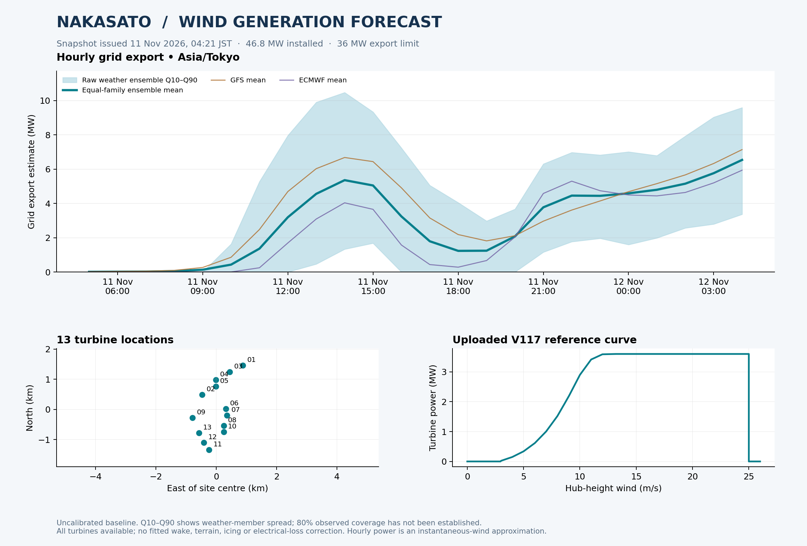

# Nakasato wind generation forecasting model

A runnable **hourly, 24-hour wind generation forecasting model requiring no SCADA data** for the 13 turbine locations in your Google My Maps file. It uses your uploaded V117 power curve and a genuine weather ensemble: **31 GFS + 51 ECMWF members** in the included live snapshot. Each weather family has 50% total weight. A JMA MSM forecast is included as a comparison.

**What works now:** live API acquisition, per-turbine and farm forecasts, grid export limiting, raw weather quantiles, CSV/Excel/chart outputs, and offline replay of the included snapshot.

**No historical generation, measured wind or ambient temperature is needed to run this version.** It is a physical weather ensemble, with explicit fixed assumptions instead of fitted site parameters. Forecast accuracy and quantile coverage have not been measured against plant output. Historical data can support optional later calibration.



## Downloads

- [Complete project ZIP](downloads/Nakasato_Wind_Forecast.zip) — code, notebook, input data, saved weather and example outputs. Open the file on GitHub and select **Download raw file**.
- [24-hour example forecast workbook](examples/forecast/Nakasato_forecast.xlsx)
- [Model guide PDF](reports/Nakasato_Model_Guide.pdf)

The included example is dated 11 November 2026 in Japan time. Run the live command below to obtain a fresh forecast.

## Open these first

- `Nakasato_Wind_Forecast.ipynb`: guided notebook with the model, charts and optional live/training cells.
- `examples/forecast/Nakasato_forecast.xlsx`: actual API-driven example, with hourly farm export, all 13 turbines, JMA benchmark, curve and grid audit.
- `examples/forecast/forecast_overview.png`: overview chart.
- `MODEL_CARD.md`: assumptions, formulas and validation design.
- `DATA_REQUIREMENTS.md`: historical data schema and timestamp rules.

## Run locally

Use Python **3.11 or newer**. Open a terminal in the extracted `Nakasato_Wind_Forecast` folder.

```bash
python -m venv .venv
# macOS / Linux:
source .venv/bin/activate
# Windows PowerShell instead:
# .venv\Scripts\Activate.ps1
python -m pip install -r requirements.txt

# Reproduce the included result without API access:
python -m wind_forecast forecast --replay examples/weather_snapshot --out runs/replayed

# Fetch a new 24-hour forecast at every turbine coordinate:
python -m wind_forecast forecast --hours 24

# Software correctness tests:
python -m unittest discover -s tests -v
```

A live run saves raw API responses under `weather_archive/<timestamp>/` and outputs under a new `runs/<timestamp>/`. Keep these folders to build your training archive. No API key is required for the public research endpoints used here; check [Open-Meteo's terms and service plans](https://open-meteo.com/en/pricing) for your intended deployment and usage. Internet access is needed for live acquisition, but not for replay.

For Jupyter, install `jupyterlab` in the same environment, run `jupyter lab`, then open the notebook. Its default workflow replays the supplied data; live fetching and training are separate optional cells. On Google Colab, extract the full ZIP and set the notebook's `ROOT` to that extracted folder.

## How the ensemble works

1. Request GFS and ECMWF ensemble wind speed and direction at 100 m for **every turbine coordinate**, with wind speed explicitly in m/s.
2. Adjust to the assumed installed hub height, 116.5 m, using a configurable power-law exponent of 0.14. Apply optional per-turbine and directional wind multipliers.
3. Convert **each member separately** through the sorted, supplied 3.6 MW curve. Apply availability and known power limits, then preserve each family/member across all turbines and hours.
4. For farm export, sum all 13 turbines within each scenario, apply electrical losses, then the **36 MW export cap**. Average these capped scenarios with equal family weights.
5. Report mean, Q10, Q50 and Q90. These are **uncalibrated weather-member quantiles**, not demonstrated 80% prediction coverage.

The two supplied density tables are identical. The baseline selects 1.225 kg/m³ and applies no additional density correction. Workbook units are inferred from numerical ranges; confirm m/s, kW and kg/m³ with the data owner.

The 36 MW export limit is material: installed turbine capacity is 46.8 MW. [Vena's project announcement](https://venagroup.com/vena-energy-secures-jpy14-5b-shinsei-green-loan-for-the-construction-of-the-nakasato-wind-project-in-aomori-prefecture/) supports those capacities; its [hub-height announcement](https://project.venaenergy.co.jp/information/1078) gives 116.5 m. Confirm current operating settings before operational use.

JMA MSM's documented near-surface wind is at 10 m. Here it is extrapolated using the same configurable shear assumption and retained as a **benchmark**, outside the GFS/ECMWF ensemble. [JMA API documentation](https://open-meteo.com/en/docs/jma-api).

## Optional later stage: supervised calibration

This section is not required for the current SCADA-free 24-hour ensemble. The user reports potential historical coverage from **29 July 2022 to 4 November 2026**, but those files have not been supplied. Measured wind/temperature are useful for diagnostics; the current model obtains wind forecasts from the API.

The optional learned model combines the physical mean with **Random Forest, histogram gradient boosting, and Ridge residual corrections**. It learns nonnegative weights summing to one from purged chronological validation folds. The last 20% of forecast issue times is held out; training targets and label timestamps must precede the next validation origin.

```bash
python -m wind_forecast train --features "runs/**/forecast_features.csv" --scada data/scada.csv --out models/calibrated
python -m wind_forecast predict-ml --model models/calibrated/model.pkl --features runs/NEW_RUN/forecast_features.csv --out runs/NEW_RUN/ml_turbine_points.csv
```

Replace `NEW_RUN` with an actual future run folder. The training command writes holdout metrics, predictions, fold audits, an evaluated model, and a separate production refit. Load only locally trusted pickle model files. Learned output is **turbine point power**, and remains separate from the raw weather quantiles. It does not calibrate an export distribution.

Use archived forecasts available at each historical issue time. Pairing historical measured/reanalysis weather with generation would answer a different question and can exaggerate forecast skill. The exact member-based features require archived ensemble members. [Open-Meteo's Single Runs API](https://open-meteo.com/en/docs/single-runs-api) can support a separate deterministic historical baseline, but does not guarantee a full member archive for the user's entire 2022–2026 period. A historical reconstruction adapter is not implemented here. None of this is needed to run the current physical ensemble.

An ensemble is a sound candidate for your professor's suggested comparison, but improvement is an empirical question. Evaluate persistence, individual physical/weather families, each learned model, and the stack on identical held-out periods and horizons. A future LSTM benchmark should use those same forecast inputs and splits.

## Configuration

- `data/turbines.csv`: exact map coordinates, hub height, rating, wind multiplier and default availability.
- `config.json`: family weights, shear, grid cap, electrical losses, cut-out/restart settings and optional directional multipliers.
- `data/power_curve.csv`: selected and sorted reference curve; the original workbook is also included.
- `--plan path/to/plan.csv`: optional known-at-issue availability/power limits. See the header-only template and schema.

Default availability is 1, wind multipliers are 1, and electrical loss is 0. These are explicit assumptions. Wake, terrain, icing, unplanned outages, dynamic dispatch and meter-level losses are not yet fitted. Same-grid turbines can consequently receive identical initial forecasts, which is more defensible than inventing local differences.

Do not sum turbine quantiles to obtain farm quantiles. `farm_scenarios.csv` preserves the joint scenarios for that calculation. `horizon_energy_proxy.csv` likewise sums complete trajectories before calculating horizon quantiles. Energy outputs assume each hourly power sample represents one hour; the weather wind fields are instantaneous, so this is an approximation.
